# Manual del vendedor · CRM NANOBRIDGE

**Para:** quien vende y da seguimiento a los clientes en el CRM (agentes y supervisores).
**Versión:** 0.9 · 4 de noviembre de 2026. Pasa a 1.0 al cierre, con lo que salga del piloto. Las capturas son del CRM con
datos de ejemplo: ningún nombre ni correo es de un cliente real.

El CRM está en **https://crm-prospeccion-outbound.web.app**. Funciona en la computadora y en el celular.

## 1. Lo básico

**Entrar.** Con tu correo y tu contraseña (12 caracteres o más). Si te equivocas varias veces seguidas, espera unos
minutos antes de volver a intentar. Si no tienes cuenta o la olvidaste, pídesela a un administrador.

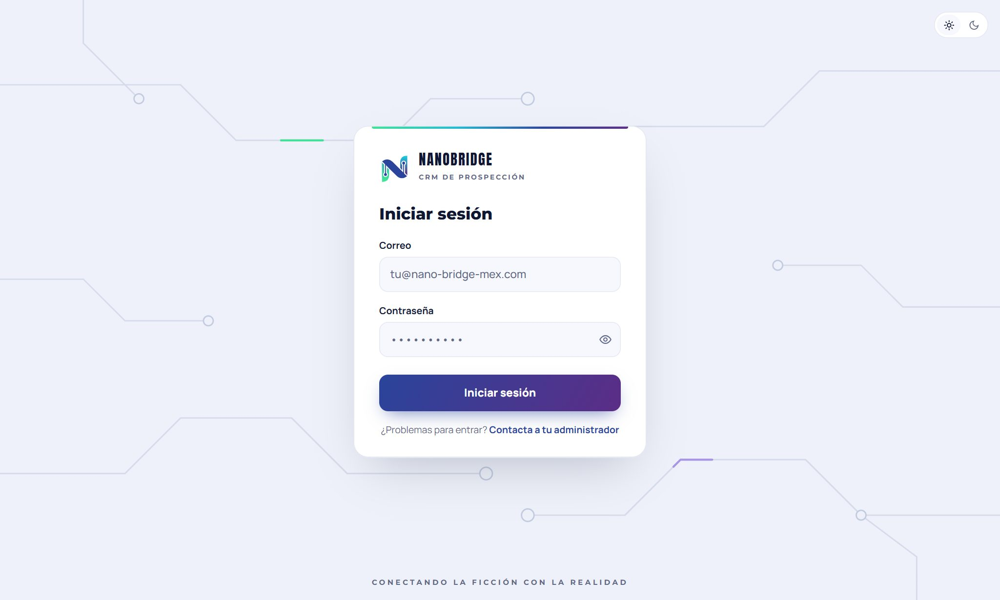

**Qué ves según tu rol:**

| Rol | Qué ve y qué puede hacer |
|---|---|
| **Agente** (vendedor) | Solo las empresas de las que es responsable y todo lo que cuelga de ellas: contactos, oportunidades, cotizaciones, documentos y tareas. Reportes: solo lo suyo del día |
| **Supervisor** | Todo, además de clasificar respuestas, asignar tareas, revisar documentos, mandar prospectos a la automatización, editar los correos de prospección y ver Administración |
| **Administrador** | Todo lo anterior, más usuarios, fusionar empresas repetidas y el estado del sistema |

**El menú:** Inicio, Empresas, Contactos, Prospectos, Tareas, Oportunidades, Cotizaciones, Documentos, Reportes y
Administración (esta solo la ven supervisores y administradores). En el celular, los más usados van en la barra de abajo
y el resto en «Más».

**Buscar cualquier cosa:** **Ctrl + K** (en Mac, Cmd + K), la caja de búsqueda del menú o la lupa en el celular. Busca
a la vez en empresas, contactos, prospectos, oportunidades, cotizaciones y tareas.

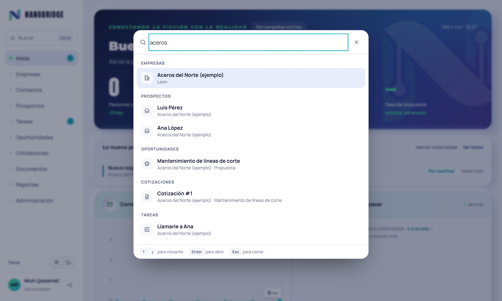

**Modo día o noche:** «Tema», al final del menú.

## 2. Tu día

1. **Inicio.** Arriba, «Lo nuevo para ti»: los avisos que no has leído (una tarea que te asignaron, un interesado, una
   tarea vencida, un documento rechazado). El numerito de Inicio en el menú dice cuántos hay.

   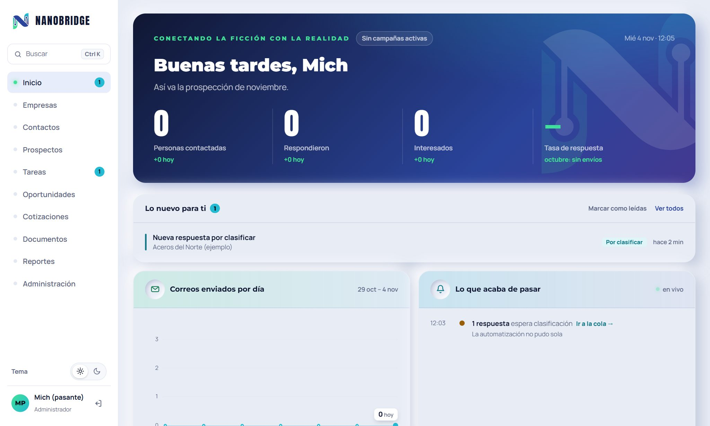
2. **Tareas → Mi día.** Lo que tienes que hacer hoy y lo que ya venció (el numerito de Tareas en el menú), una por una
   y la más urgente primero. Para cada una: **Hecha** (escribes qué pasó y queda en el Historial), **Reprogramar** (para
   otro día) o **Saltar** (pasa a la siguiente y la deja para después). «Ver todas» enseña también las de otros días.

   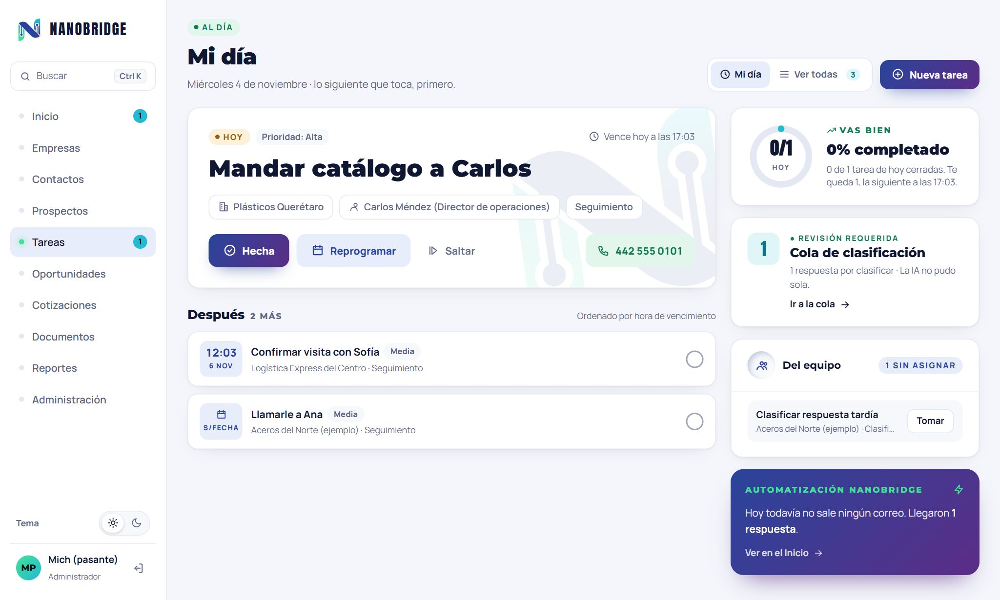
3. **Si te llegó un interesado** (la tarea «Contactar prospecto interesado»): vence al final del siguiente día hábil.
   Atiéndela primero: si en un día hábil nadie la toma, sube a urgente y se avisa a los supervisores.

**Avisos por correo:** además de verlos en Inicio, puedes recibirlos en tu correo. Se elige en «Lo nuevo para ti».

## 3. Empresas y contactos

**Encontrar una empresa:** Empresas → busca por nombre, giro o ciudad. Los contadores de arriba también filtran.

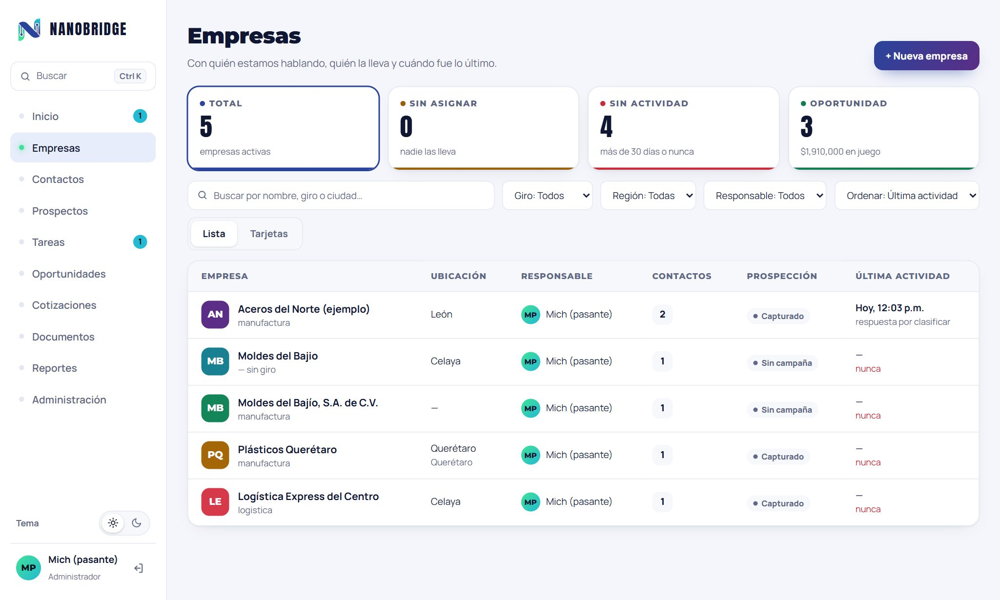

**Dar de alta una empresa:** Empresas → «+ Nueva empresa», con su primer contacto (nombre y al menos un correo,
teléfono o WhatsApp). **Si sale «Ya hay una empresa con este nombre»**, revisa si es la misma antes de crear otra: el
CRM compara sin mayúsculas, acentos ni «S.A. de C.V.».

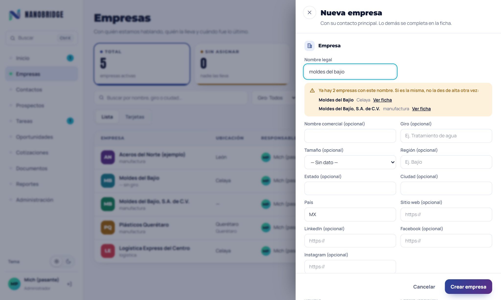

**La ficha de la empresa** es donde está todo. Arriba, cuatro datos y los botones:

| Botón | Para qué |
|---|---|
| **+ Oportunidad** | Abrir un trato con esta empresa (§5) |
| **Nueva tarea** | Algo que hay que hacer: llamar, mandar algo, dar seguimiento |
| **Editar** | Corregir datos de la empresa: nombre, giro, tamaño, ubicación, responsable |
| **Fusionar** (administrador) | Si la empresa está repetida: todo pasa a la que se queda |
| **Desactivar** (supervisor y administrador) | Si la empresa ya no sirve. No se borra |

Abajo, el **Resumen** (contactos, historial y oportunidades abiertas) y las pestañas Oportunidades, Cotizaciones y
Documentos.

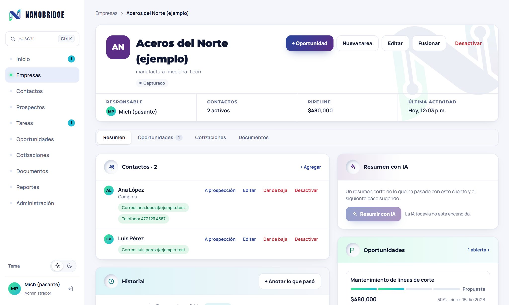

**Contactos de la empresa.** En la tarjeta Contactos:
- **+ Agregar** una persona; **Editar** sus datos. Borrar el valor de un correo o teléfono no lo elimina: queda como
  «obsoleto».
- **A prospección**: la manda a Prospectos para que la automatización le escriba (solo si tiene correo activo).
- **Dar de baja**: si la persona te pidió **por teléfono o en persona** que no le escriban. Escribe cómo lo pidió.
  Sus correos y teléfonos pasan a «no contactar», sus prospectos a baja y sus seguimientos se cancelan. **No se
  deshace.**

  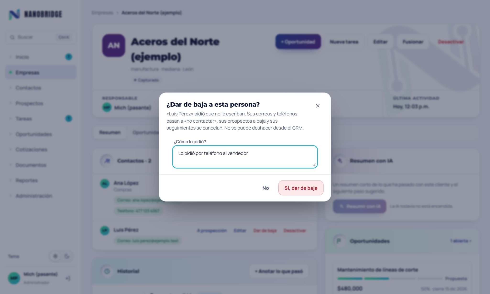
- **Desactivar**: si la persona ya no trabaja ahí. Su correo y su teléfono siguen apartados.

Un correo o teléfono en **«no contactar»** es de alguien que pidió su baja: se ve, pero no se puede editar ni usar.

**El Historial** (en el Resumen de la ficha) junta todo lo que ha pasado con la empresa: correos enviados y
respondidos, llamadas, tareas cerradas, cambios de estado, cotizaciones enviadas y documentos. **+ Anotar lo que pasó**
para registrar una llamada, una reunión o un WhatsApp.

**Resumir con IA:** en la ficha, un resumen del historial de la empresa para ponerte al día rápido. Lo propone la IA:
léelo con criterio. Hay un límite de 20 al día por persona.

**Contactos** (en el menú): todas las personas en una sola lista, para buscar a alguien sin saber su empresa. Los
filtros dicen a quién se le puede escribir.

## 4. Prospectos y respuestas

**Prospectos** son las personas a las que todavía no les vendemos y a las que la automatización les puede escribir.

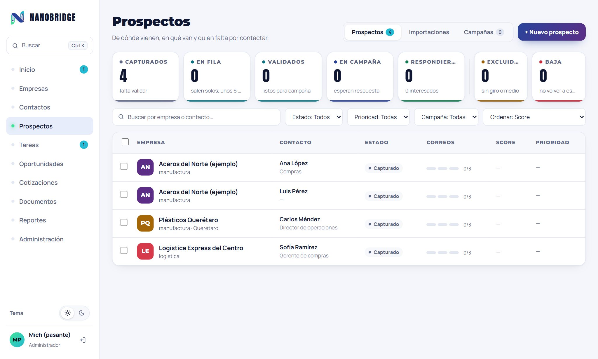

- **Alta de uno:** Prospectos → «+ Nuevo prospecto»: de una empresa nueva o de una que ya existe («Ya existe en el CRM»).
- **Varios a la vez:** Prospectos → Importaciones → «Descargar plantilla», llénala y súbela. Nada entra hasta que
  revisas y confirmas cada fila. Las filas «Duplicada» son personas que ya existen. Las que tienen una empresa con el
  mismo nombre te dejan elegir «Confirmar en …» (la que ya existe) o «Es otra empresa». Detalle en el
  [manual de datos](MANUAL_DE_DATOS.md).

  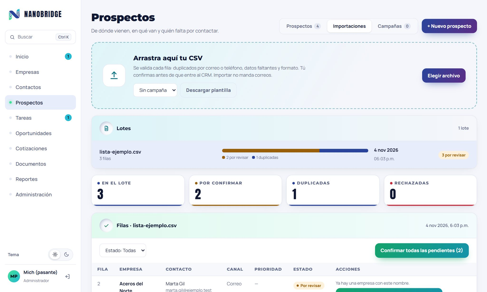
- **Mandar a la automatización** (supervisor y administrador): elegir prospectos → «Mandar a automatización», con la
  campaña. Solo entran los que tienen giro, tamaño y correo; los demás regresan con su motivo.

**Cuando un prospecto responde:**
1. Su respuesta cae en la **cola de clasificación** (Tareas → Ver todas → «Cola de clasificación»; la ven supervisores
   y administradores). La IA
   sugiere qué es; una persona decide: **Interesado**, **No interesado**, **Baja**, **Inválido** o **Reagendar** (pide
   la fecha para volver a buscarlo).

   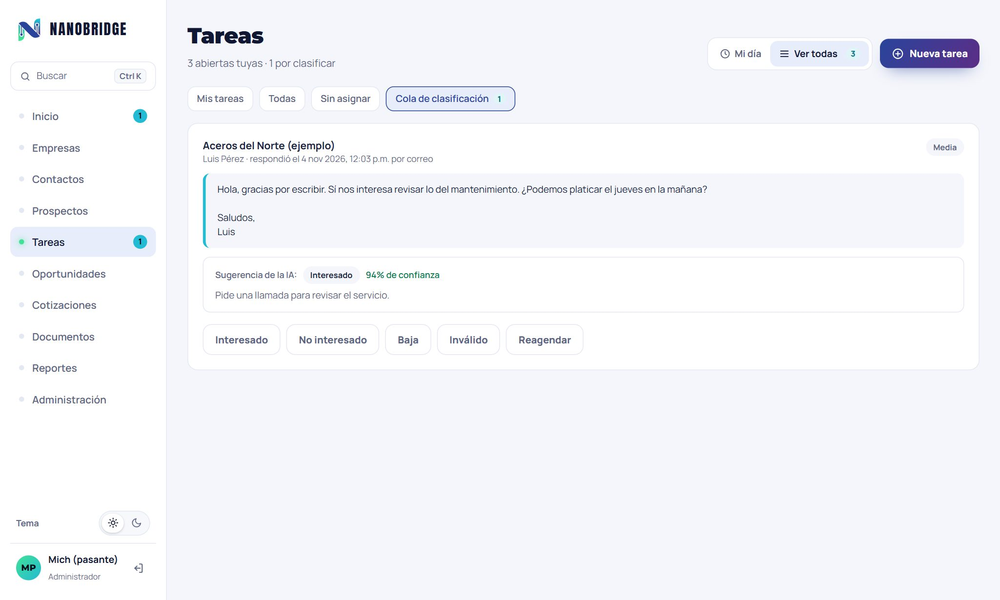
2. **Interesado:** se crea la tarea «Contactar prospecto interesado» para un vendedor. Desde la cola, **Responder
   ahora** te deja contestarle de inmediato y la tarea queda contigo.
3. **Para contestarle:** «Responder por correo». **Redactar con IA** te propone un borrador con lo que él escribió y el
   correo que se le mandó; revísalo y cámbialo antes de mandarlo. El correo sale con tu nombre y su respuesta te
   llega a ti.
4. **Baja:** no se le vuelve a escribir, nunca. No se deshace desde el CRM.

## 5. Oportunidades

Una **oportunidad** es un trato posible con una empresa: qué se le quiere vender, por cuánto y qué tan probable es.

- **Crear:** desde la ficha («+ Oportunidad») o desde Oportunidades.

  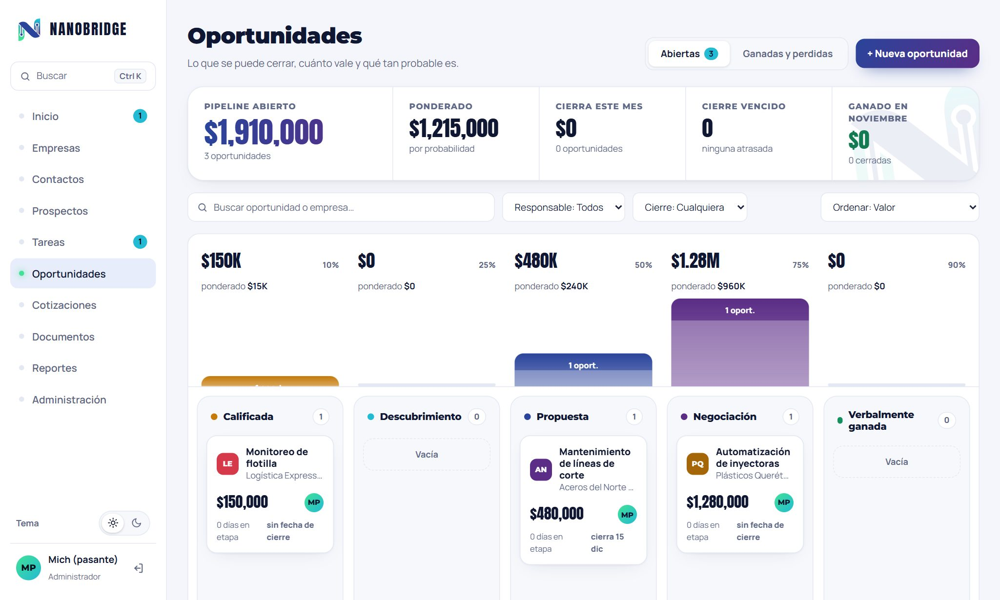
- **El tablero** tiene una columna por etapa. **Arrastra la tarjeta** para cambiarla de etapa. Para ganarla, llévala a
  «✓ Ganada» y confirma: queda cerrada y **ya no se reabre**. **Marcar perdida** pide el motivo; una perdida sí se puede
  reabrir.
- **Abrir una oportunidad** muestra su detalle: contacto, valor, cotizaciones, papeles y tareas.
- **Papeles de la venta:** al ganar, el expediente pide los papeles obligatorios (cotización, pago, recibido o guía, y
  la constancia fiscal si **Lleva factura**). Se suben en Documentos o en la pestaña Documentos de la ficha.
- **Aceptar una cotización gana su oportunidad** automáticamente, con el total aceptado.

## 6. Cotizaciones

- **Hacer una:** Cotizaciones → «+ Nueva cotización» (o desde la oportunidad). Por pasos: empresa y oportunidad,
  partidas («+ Agregar partida»), descuento e impuestos, y «Revisar y enviar».

  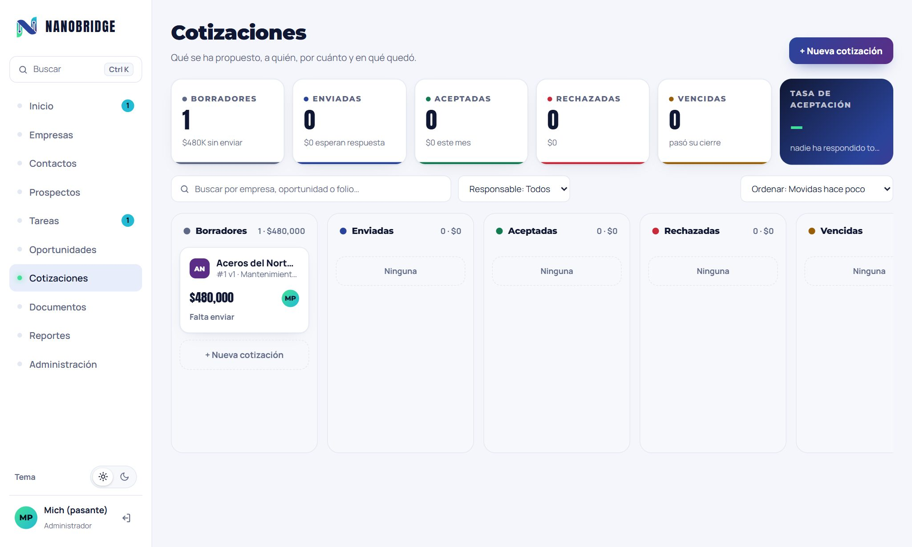
- **Mandar por correo:** la cotización sale con el PDF adjunto, firmada con tu nombre, y la respuesta del cliente te
  llega a ti. Queda en el Historial de la ficha.
- **Cambiarla:** «Nueva versión». La anterior se conserva.
- **En qué quedó:** el tablero tiene una columna por estado. Márcala aceptada o **Marcar rechazada** (con el motivo).
  Las que pasan su fecha de cierre sin respuesta se vencen solas.
- **Seguimiento:** si a los 5 días hábiles de mandarla el cliente no ha contestado, al responsable le queda una tarea
  «Dar seguimiento a cotización». Se cancela sola si la cotización se acepta, se rechaza, vence, sale otra versión o se
  cierra la oportunidad.

## 7. Documentos

- **Subir documento:** desde Documentos o desde la pestaña Documentos de la ficha. Se aceptan PDF, Word, Excel, PNG y
  JPG de hasta 25 MB.

  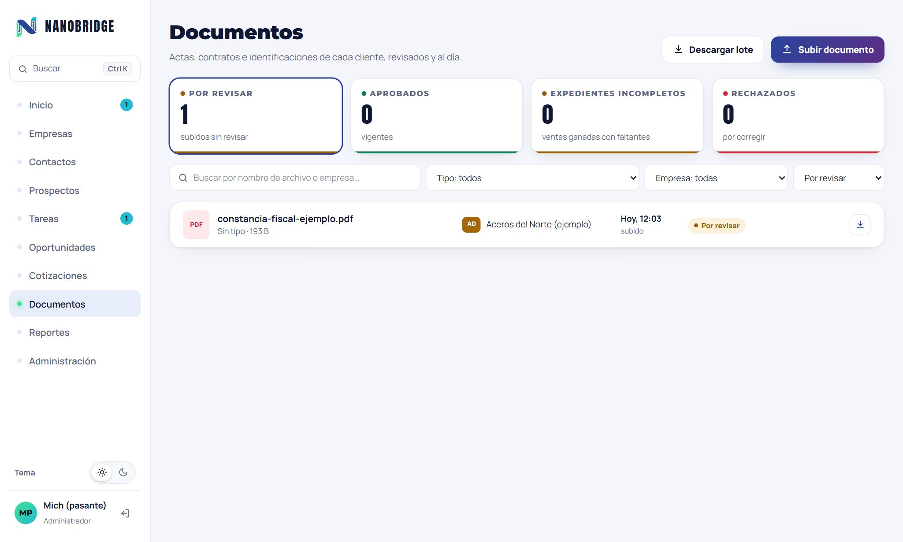
- **Revisión** (supervisor y administrador): abrir el documento → **Aprobar** o **Rechazar documento** con el motivo. Si
  se rechaza, a quien lo subió le llega el aviso y una tarea para corregirlo.
- **Descargar lote:** varios documentos en un zip.

## 8. Reportes

- **Agente:** Reportes → **Día**: lo que hiciste hoy (tareas, correos, respuestas).

  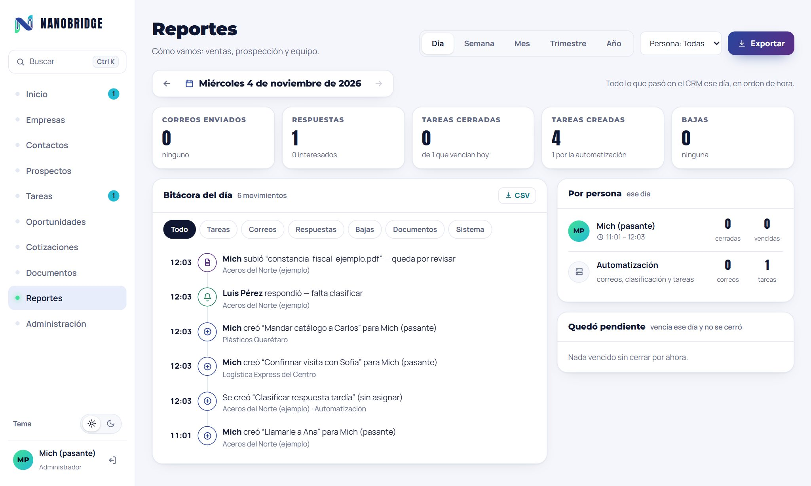
- **Supervisor y administrador:** Día, Semana, Mes, Trimestre y Año, cada uno contra el periodo anterior: ventas,
  prospección y equipo. Desde Oportunidades se descarga el **informe ejecutivo** en PDF.

## 9. Lo que conviene saber

- **Nada se borra:** empresas, contactos y documentos se desactivan; el historial se conserva.
- **Todo cambio queda registrado** con quién lo hizo y el antes y el después (Administración → Registro de cambios).
- **Un agente solo ve lo suyo.** Si necesitas una empresa de otro, pídesela a un supervisor.
- **A quien pidió la baja no se le escribe,** ni desde la automatización ni desde el CRM.
- **La IA solo propone** (clasificación, borrador, resumen): siempre decide y revisa una persona.
- **Si algo no funciona:** anota qué estabas haciendo y la hora, y avisa al administrador.

---

Las capturas se sacan con [`capturar.cjs`](img/manual-vendedor/capturar.cjs) sobre un CRM local con los datos de
[`sembrar-ejemplo.py`](img/manual-vendedor/sembrar-ejemplo.py). Se vuelven a sacar cuando cambie una pantalla.
